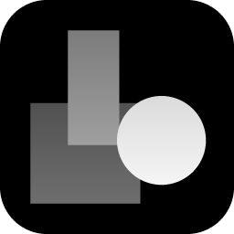
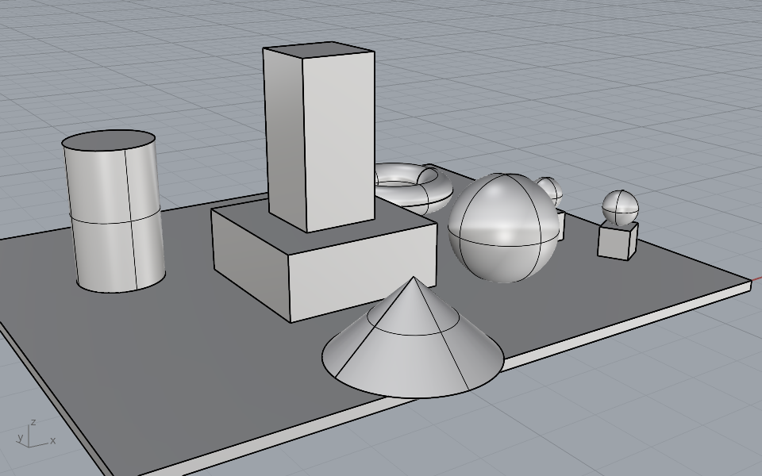
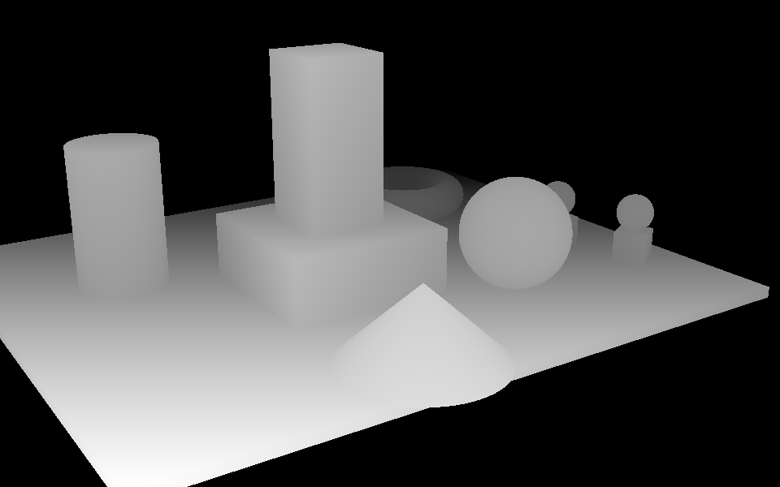

# ZDepth



ZDepth plug-in for Rhinoceros® 8. Shows the **depth pass** (z-buffer) live in the viewport
and saves it as a depth map at any size: 8-bit PNG for ControlNet or Photoshop, 16-bit
PNG, or float EXR in model units for compositing. Works on the Mac, where Rhino's own
`ShowZBuffer` shows nothing. Written in C# / RhinoCommon for Mac and Windows.

> **Beta (0.9.1-beta).** Tested on Rhino 8 for Mac; Windows is untested so far.

| Shaded | ZDepth |
|---|---|
|  |  |

## Why

On Rhino 8 for Mac, `ShowZBuffer` toggles without changing the viewport
([forum thread](https://discourse.mcneel.com/t/showzbuffer-not-working-in-rhino-8-mac/180079),
logged as RH-82309). The depth is there: Rhino's `ZBufferCapture` returns correct values
for every pixel. Only the step that turns them into a picture is Windows-only (it returns
a Windows `HBITMAP`), and on the Mac it returns nothing, so `ShowZBuffer` has nothing to
draw. ZDepth draws the depth itself, and renders the files on its own.

## Installation

Rhino 8 (Mac or Windows):

- **From the Package Manager**: run `PackageManager`, search for *ZDepth* and tick
  *Include pre-releases* (beta versions are hidden without it). Install, then restart
  Rhino.
- **From the package file**: download [`dist/zdepth-0.9.1-beta-rh8_0-any.yak`](dist/) and drag
  it into a Rhino window. Restart Rhino.
- **Or from the command line**, with this repository checked out:

  ```sh
  yak install --source ./dist ZDepth
  ```

  `yak` comes with Rhino: `/Applications/Rhino 8.app/Contents/Resources/bin/yak` on the
  Mac, `C:\Program Files\Rhino 8\System\Yak.exe` on Windows.

## Usage

The commands are also on the **ZDepth** toolbar, installed with the plug-in: the left
button is **ZDepth** (right-click: **ZDepthRange**), the right one **ZDepthCapture**. If
Rhino doesn't show it as a tab, add it from the menu at the right end of the toolbar tabs.

**ZDepth** → switches the active viewport to the *Z Depth* display mode; run it again to
switch back to the mode it had before. You can also pick *Z Depth* from any viewport's
display mode menu. It stays live while you orbit.

**ZDepthRange** → how depth maps to grey:

- *Range* `Auto` fits near and far to the nearest and farthest geometry in the view,
  every frame (the view and the captures agree). `Fixed` uses *Near* and *Far* (model
  units) and keeps the greys constant across views and animation frames. *FromView* fixes
  the range to the nearest and farthest surface visible now. The range is saved in the
  document.
- *NearIs* `White` (default, the depth-map convention ControlNet's depth models use) or
  `Black`. The background is always the far end.

**ZDepthCapture** → saves the active view's depth plus a JSON file next to it:

| Format | Pixels | For |
|---|---|---|
| `PNG` | 8-bit grey | ControlNet / depth-to-image, Photoshop Lens Blur, fog |
| `PNG16` | 16-bit grey | Photoshop or Affinity, without banding |
| `EXR` | 32-bit float, channel `Z`, model units (background 1e10) | compositing: Nuke, Fusion / Resolve, After Effects, Blender |

*Width* and *Height* default to the viewport; set them to your render size and the pass
lines up with the render pixel for pixel. The framing is Rhino's own for that size. The
JSON records near, far, units, how grey encodes depth, and the camera. See
[docs/zdepth.json](docs/zdepth.json).

What you get:

- **Depth along the view direction**, the z of a z-buffer (not the distance to the eye),
  linear between near and far.
- **Exact files.** ZDepthCapture renders the depth on the CPU from the objects the view
  shows (render meshes, blocks, clipping planes), so the file is exact at any size and does
  not depend on display settings. The viewport is a live preview of the same thing.
- **Only surfaces.** No grid, axes, curves, edges, points, annotations or lights.

Scripted form, e.g. for macros:

```
-ZDepthCapture Format=PNG Width=1920 Height=1080 Enter /path/to/depth.png Enter
-ZDepthCapture Format=EXR Width=4000 Height=3000 Enter /path/to/depth.exr Enter
-ZDepthRange Range=Fixed Near=1000 Far=5000 Enter
```

## Build

Requires the [.NET SDK](https://dotnet.microsoft.com/download) 7 or later.

```sh
dotnet build -c Release
```

This builds `bin/Release/net7.0/ZDepth.rhp` (Rhino 8, Mac and Windows) and
`bin/Release/net48/ZDepth.rhp` (Rhino 8, Windows), and, when Rhino 8 is installed, packs
both into `dist/zdepth-<version>-rh8_0-any.yak`. The package manifest is generated from
the properties in `ZDepth.csproj`: change the version there. The toolbar and icons are
generated by `python3 tools/make_ui.py`.

Rhino can't unload a plug-in: restart Rhino after rebuilding to pick up changes.
`Properties/launchSettings.json` has profiles to start Rhino 8 (Mac and Windows) with the
build output loaded.

To publish a new version to the Rhino Package Manager:

```sh
yak login
yak push dist/zdepth-<version>-rh8_0-any.yak
```

## How it works

| Path | Role |
|---|---|
| `src/ZDepthPlugin.cs` | Loads with Rhino: creates the display mode and the conduit. |
| `src/ZDepthSettings.cs` | Range (in the document) and which end is white (Rhino settings). |
| `src/Commands/` | `ZDepth`, `ZDepthRange` and `ZDepthCapture`. |
| `src/Display/ZDepthDisplayMode.cs` | Creates the *Z Depth* display mode (a copy of Shaded, so Rhino keeps building render meshes) and switches everything but surfaces off. |
| `src/Display/ZDepthConduit.cs` | The live view: paints the background, stops Rhino drawing each object, and redraws its render meshes with unlit vertex colours, grey by depth. During a capture it records what the view draws instead. |
| `src/Capture/DepthCapture.cs` | A capture: probes the view at the requested size, collects the meshes, rasterizes. |
| `src/Capture/DepthCamera.cs` | Camera, frustum and pixel mapping; polygon clipping in camera space. |
| `src/Capture/DepthScene.cs` | Render meshes of the objects a view draws, blocks included. |
| `src/Capture/DepthRaster.cs` | The CPU rasterizer: clips triangles to the frustum and clipping planes, z-buffers them. |
| `src/Capture/ImageWriters.cs` | Greyscale PNG (8/16 bit) and float EXR writers, no dependencies. |
| `resources/` | Toolbar (`ZDepth.rui`) and plug-in icon, generated by `tools/make_ui.py`. |
| `docs/` | README images, the scene they come from (`test-scene.3dm`) and a sample JSON. |
| `dist/` | The Yak package, its manifest and icon. |

**The live view.** Depth along the view direction is an affine function of position, and
the GPU interpolates vertex colours perspective-correctly, so a vertex-coloured triangle
shows its exact depth, as long as no vertex has to be clamped to white or black. Triangles
that cross the near or far end of the range are therefore cut there every frame and the
pieces beyond drawn flat. About 10 ms per frame for 100,000 vertices on an Apple-silicon
Mac.

**The captures.** A probe capture at the requested size, with all drawing suppressed,
records which objects Rhino draws in the view and its exact frustum at that size (large
captures are drawn in tiles; their frustums are combined). ZDepth then rasterizes the
render meshes itself, with 1/depth interpolated across each triangle. In a 15 m deep test
scene it agrees with Rhino's own depth buffer to 1.5 cm (median), and silhouettes match
Rhino's captures to 99.7 %, tiled ones included. About 0.1 s at 1000 × 1300 and 0.5 s at
4800 × 3200 for that scene.

Quirks of Rhino 8 for Mac this works around:

- `ZBufferCapture.GrayscaleDib()` returns nothing (it is a Windows `HBITMAP`); that is why
  `ShowZBuffer` shows nothing. Its per-pixel values do work, but only at the view's size.
- Display captures change the greys of what was drawn (a grey of 128 comes back as about
  158), so files are not taken from the display.
- `ViewCapture` was seen returning empty images within a session; the probe uses
  `RhinoView.CaptureToBitmap`, which frames identically.
- `Color.FromArgb` costs about half a microsecond inside Rhino; the conduit uses a
  256-entry grey palette.
- `DisplayPipeline.DrawGradientMesh` draws nothing, so it can't do the depth on the GPU.
- As in [ClownID](https://github.com/adpchrgruber/ClownID_Rh8): meshes are drawn in
  `PostDrawObjects`, and the conduit paints the background itself.

## Notes

- Only objects with render meshes appear: surfaces, polysurfaces, extrusions, SubDs,
  meshes, and blocks of them. SubDs, for which Rhino usually keeps no render mesh, are
  meshed by ZDepth at the default display density. Clipping planes that cut the view are applied.
- Grasshopper previews are not document objects and don't appear. Bake them first.
- The viewport is a preview: its greys go through Rhino's display colour handling. For
  exact values use ZDepthCapture rather than ViewCaptureToFile.
- With *Range* `Auto`, geometry hidden behind other objects still counts towards near and
  far. *FromView* uses only what is visible.
- While a Z Depth view is open, ZDepth keeps a copy of each visible object's render mesh
  (one per block instance).
- Tested on Rhino 8.35 for Mac.

## Credits and AI disclosure

ZDepth was co-created by **adpchrgruber** and generative AI.

**Use of generative AI.** The plug-in was developed in conversation with *Claude Opus 5.5*
(Anthropic), working as a coding agent in *Claude Code*, in October 2026. The AI:

- traced why `ShowZBuffer` shows nothing on the Mac, by experiments in a live Rhino 8
  session through McNeel's Rhino MCP Platform;
- wrote the C# source code (display mode, CPU rasterizer, PNG and EXR writers), the build
  and packaging setup (`ZDepth.csproj`, the Yak package) and `tools/make_ui.py`, which
  draws the icons and the toolbar;
- tested the results against Rhino's own depth buffer and captures (the measurements are
  under *How it works*);
- drafted this README, the changelog and the release notes.

**Human contribution.** adpchrgruber conceived the plug-in, set its requirements and
direction, made the design and naming decisions, reviewed the results, tested it on
Rhino 8 for Mac, and published it. The author takes responsibility for the released
software.

**Citing the AI tools.** APA 7:

> Anthropic. (2026). *Claude* (Opus 5.5 version) [Large language model].
> https://www.anthropic.com/claude
>
> Anthropic. (2026). *Claude Code* [Computer software]. https://claude.com/claude-code

Chicago (note):

> 1. Code and text generated by Claude Opus 5.5, Anthropic, via Claude Code, October 2026,
> https://claude.com/claude-code; prompted, reviewed and tested by adpchrgruber.

**Citing ZDepth.** See [`CITATION.cff`](CITATION.cff), or *Cite this repository* on the
GitHub page.

**Acknowledgements.** The bug and a workaround were first discussed in the McNeel forum
thread [ShowZBuffer not working in Rhino 8 Mac](https://discourse.mcneel.com/t/showzbuffer-not-working-in-rhino-8-mac/180079).
The project structure follows [ClownID](https://github.com/adpchrgruber/ClownID_Rh8),
whose packaging layout follows [Obliq](https://github.com/criticalsoftware-lab/obliq) by
Critical Software Lab (MIT License). The project was started from McNeel's
`Rhino.Templates`. Rhinoceros® is a registered trademark of Robert McNeel & Associates;
ZDepth is not affiliated with or endorsed by McNeel.

## License

[MIT](LICENSE)
